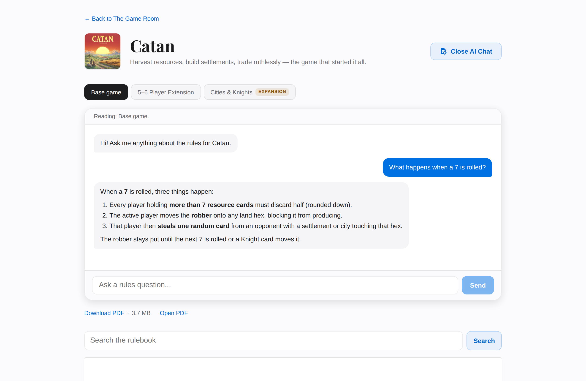
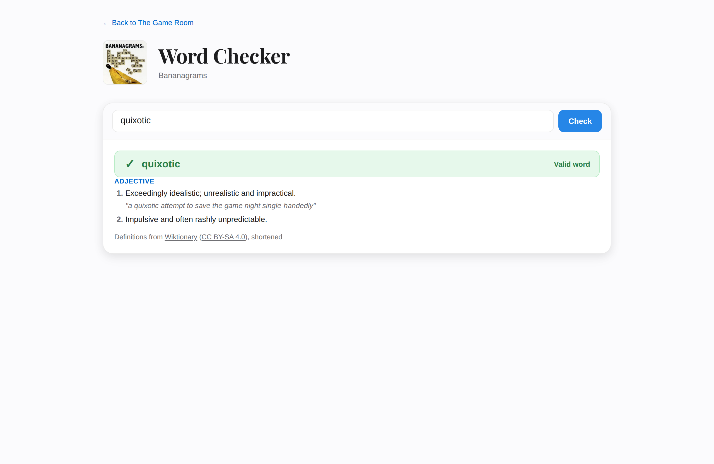
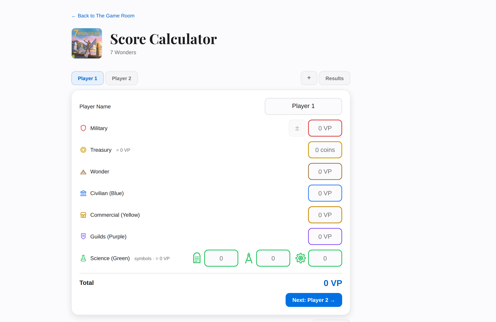

# The Game Room

A single-page web app for browsing a personal board game collection — filter and
sort 30 games by length, player count, and vibe; get a "pick for us" random
suggestion; read bundled rulebooks; ask an **AI rules assistant**; keep score
for **7 Wonders**, **Ticket to Ride**, **Dominion** and the card games; check
whether a word is playable in **Bananagrams**; and
vote on a shared wishlist.

Built with React 19 + TypeScript on Vite, with a small set of Vercel serverless
functions for the AI and voting features.


## Highlights

- **Fast, shareable filtering.** Time budget, player count, and keyword filters plus
  full-text search and multiple sort modes, driven by a `useReducer` store that
  mirrors its state into the URL — so any filtered view can be copied and shared.
- **Grid and list views** over the same 26-game collection, with a one-click
  random "pick for us" suggestion.
- **AI rules assistant.** Each game's rulebook PDF is extracted to text and fed to
  Google Gemini, which answers rules questions grounded only in that game's rules
  and streams the reply token-by-token.
- **Score pads.** 7 Wonders with the full scoring model, including the
  quadratic science formula; Ticket to Ride (US and Europe) from routes by
  length and tickets; Dominion with Intrigue's Victory cards; and a running
  score, round by round, for Uno, Rummy, Hearts, Golf, Spades and Euchre.
- **Bananagrams word checker** backed by a bundled word-game list (ENABLE),
  with a public dictionary API for meanings and newer words.
- **Anonymous wishlist voting** stored in Upstash Redis.
- **Friend suggestions with email approval**: anyone can suggest a game; the
  owner gets an email with Approve and Deny links, and approved games join
  the wishlist credited to the suggester, with details and box art from
  BoardGameGeek.
- **Owner sign-in by magic link** (`/sign-in`): signed in, the wishlist shows
  the pending queue, an add-a-game form and edit/remove controls.
- **Accessibility-tested UI** — `eslint-plugin-jsx-a11y-x` static checks plus
  `axe-core` assertions on rendered components in CI.

## Screenshots

| AI rules assistant | Word checker | 7 Wonders score calculator |
| --- | --- | --- |
|  |  |  |

A sortable list view is also available:


> The AI-assistant and word-checker screenshots use locally stubbed API responses
> purely for capture; the app calls the real services at runtime.

## Tech stack

- **Frontend:** React 19, TypeScript 7 (strict), React Router 7, Vite 8,
  Tailwind CSS 4 (every style a utility class; the tokens in `src/index.css`)
- **Content:** `react-markdown` for AI answers; rule PDFs rendered inline
- **Backend:** Vercel serverless functions (`@vercel/node`)
- **AI:** Google Gemini via `@google/genai` (`gemini-2.5-flash`, streamed)
- **Data / KV:** Upstash Redis (`@upstash/redis`) for wishlist votes, suggestions and owner sessions
- **Email:** Resend (REST, no SDK) for suggestion approvals
- **Monitoring:** Sentry (browser + serverless) and Vercel Analytics
- **Testing:** Vitest 5, React Testing Library, jsdom, `axe-core` / `vitest-axe`
  (per-file 80% line coverage enforced); StrykerJS mutation testing over the
  pure-logic and component code; Playwright end-to-end tests in Chromium
  against the production build, with the API stubbed
- **Tooling:** ESLint 10 (flat config, `typescript-eslint`, `jsx-a11y-x`,
  `react-hooks`, `better-tailwindcss` for the classes), Prettier, Node 24
- **Rules pipeline:** `unpdf` for text extraction with a `tesseract.js` OCR
  fallback for image-only PDFs

## Getting started

```bash
git clone https://github.com/jbhirsh/BoardGames.git
cd BoardGames
npm install

cp .env.example .env.local   # fill in values for any feature you want to run
npm run dev                  # http://localhost:5173
```

The core collection, filtering, random picker, and score calculator run with no
configuration. The AI assistant, wishlist voting, suggestions, sign-in, and
Sentry monitoring need the corresponding environment variables — see
[`.env.example`](.env.example) for the full list (Sentry DSNs, `GEMINI_API_KEY`,
Upstash Redis credentials, and the Resend key plus recipient address for
suggestion emails). Real secrets live in `.env.local`, which is gitignored.

### Scripts

| Command | Description |
| --- | --- |
| `npm run dev` | Start the Vite dev server |
| `npm run build` | Type-check (`tsc -b`) and build to `dist/` |
| `npm run preview` | Serve the production build locally |
| `npm run lint` | Run ESLint (includes static a11y checks and the Tailwind classes) |
| `npm run lint:fix` | Fix what ESLint can (Tailwind class order and spelling, among others) |
| `npx vitest run` | Run the test suite once (`--coverage` to enforce thresholds) |
| `npm run test:mutation` | Run StrykerJS mutation testing (see below) |
| `npm run test:e2e` | Build, serve and run the Playwright end-to-end suite in `e2e/` |

## Architecture

- `src/` — the React SPA: static data layer (`src/data/`), filter state and URL
  sync (`src/context/`), pure helpers (`src/utils/`), and UI (`src/components/`).
- `api/` — one Vercel serverless function, `graphql.ts`: a GraphQL API
  (GraphQL Yoga; schema in `_schema.graphql`, resolvers in `_resolvers/`) for
  the Gemini rules assistant (streamed over server-sent events), wishlist
  voting, friend suggestions with email approval and the owner's on-site
  edits, and magic-link sign-in, all on Upstash Redis. The client's typed
  documents are generated from the schema into `src/gql/`.
- `scripts/` — the PDF-to-text pipeline that generates `rules-text/` from
  `public/rules/*.pdf` for the AI assistant.
- CI runs lint, type-check, accessibility tests, unit tests with coverage, and a
  production build on every PR (`.github/workflows/`), plus the Playwright
  end-to-end suite (`e2e.yml`) and a mutation-testing workflow — PR-scoped
  runs and a monthly full sweep (see below).

See [`CLAUDE.md`](CLAUDE.md) for a deeper tour of the codebase and conventions.

## Answer-quality evaluation

The AI rules assistant is only useful if its answers are right, so the repo
includes an evaluation harness that measures answer quality against a **golden
set** ([`eval/golden-set.json`](eval/golden-set.json)) — a fixed list of rules
questions with verified answers and verbatim source quotes from the extracted
rulebook text in `rules-text/`. The set deliberately includes hard cases:
questions the rulebooks don't answer (the assistant should say so rather than
guess) and questions that mean different things in different games
(cross-game disambiguation).

**Run it locally:**

```bash
GEMINI_API_KEY=... npm run eval
```

The harness runs every golden-set question through the real rules-assistant
pipeline (`api/_lib/rulesAssistant.ts`, which the chat uses), so it needs a `GEMINI_API_KEY` and makes real Gemini calls. It exits
nonzero if the pass rate falls below the threshold, which defaults to **90%**
and is configurable — see [`eval/run-eval.ts`](eval/run-eval.ts).

**In CI:** the eval runs as a separate workflow
([`.github/workflows/eval.yml`](.github/workflows/eval.yml)), not as part of
the unit-test job, because it costs real API calls. It calls Gemini only when
the AI code — the rules assistant (`api/_lib/rulesAssistant.ts`), `eval/**`
or `rules-text/**` — changes, and never for a draft: when a PR opens ready, is
reopened or is marked ready, if the PR touches that code; and on a later push
unless that code is as it was when the workflow last finished a run on the PR
and that run passed. So
rebasing on, or merging in, a `main` that moved doesn't re-grade, but a push
after a failed, errored or cancelled grade does.
`.github/scripts/eval-should-grade.mjs` makes the call; a manual
`workflow_dispatch` always grades (use one after changing the workflow, which
doesn't grade on its own). A run that doesn't grade still reports the
required check, as passing. Grading every push of any PR touching
`api/` used to hit the Gemini project's monthly spend cap. It also skips
gracefully with a clear message when
`GEMINI_API_KEY` isn't available — e.g. on PRs from forks, which don't receive
repository secrets.

**Current score:** 24/26 (92.3%) — passing the 90% threshold. The two failures
are judge-graded entries where the assistant's answer included *correct* rulebook
detail beyond the reference answer, which a reference-only judge cannot verify
and so treats as unsupported. They are kept as findings rather than tuned away,
per the golden-set rule that failures are signal to investigate.

## Mutation testing

Line coverage proves a line *ran*; it says nothing about whether a test would
*fail* if that line's behavior changed. [StrykerJS](https://stryker-mutator.io/)
closes that gap: it rewrites the source — flip a boundary (`<=` → `<`), drop a
branch, empty an event handler, invert a conditional render — and reports every
mutant no test kills. Each surviving mutant is a missing assertion, so the score
is a second, sharper quality signal alongside the per-file line-coverage gate.

It's scoped to the code where the signal earns its runtime: the pure-logic layer
(`src/utils`, the filter reducer, the `api/` handlers) and the React components
(`src/components`, `src/App.tsx`). The static data layer, entry points
(`src/main.tsx`, `src/instrument.ts`), and tests are not mutated. The
`StringLiteral` mutator is disabled project-wide — in TSX it mostly mutates
`className` / `aria-label` / placeholder strings (stylistic noise), and in the
logic layer it only touches error-message text. Conditional, equality/boundary,
logical, and block-statement mutators stay on, since those catch real
rendering, interaction, and edge-case bugs.

**Run it locally:**

```bash
npm run test:mutation                                  # full run
npx stryker run --mutate "src/utils/filterGames.ts"    # scope to one file while iterating
```

The HTML report lands at `reports/mutation/mutation.html`. A `break` threshold
in [`stryker.config.json`](stryker.config.json) fails the run when the score
drops below it, so it ratchets against regressions. The pure-logic layer scores
highest (utilities and the reducer in the high-80s–90s, the API handlers ~80%);
the aggregate is pulled down by presentational component code — SVG icons, the
PDF-viewer shell, animation-driven UI — where mutation testing has little
behavior to prove.

**In CI:** mutation testing runs as its own workflow
([`.github/workflows/mutation.yml`](.github/workflows/mutation.yml)) in three
placements. On pull requests it mutates **only the lines the PR added or
changed** in the in-scope files it touched (a new file whole) — fast, targeted
feedback on exactly the code under review. A PR that changes no mutable
source skips Stryker (the check still passes), unless it touches Stryker's own
setup (its config, Vitest's, the dependencies, `patches/`, the workflow), which
runs a small utils smoke scope so a broken setup still shows. A **monthly scheduled
full sweep** (06:00 UTC on the 1st, plus manual `workflow_dispatch`) acts as a
drift sensor, catching test erosion that PR-scoped runs can't see — e.g. a test
refactor weakening assertions for untouched code — and changes to helpers, data
and dependencies that incremental runs don't notice. The whole scope is about
12,500 mutants, far more than one job can test within GitHub's time limit, so
the sweep is split into 8 parallel shards of near-equal weight
([`stryker-shards.mjs`](.github/scripts/stryker-shards.mjs)), each testing its
files from scratch; a final job merges their results, scores the whole the way
Stryker does and saves it as main's baseline
([`stryker-sweep-merge.mjs`](.github/scripts/stryker-sweep-merge.mjs)). Each
**merge to main** re-tests just what it changed to keep main's results current.
All three run incrementally (`--incremental`, results cached between runs), so
a PR's later pushes re-test only what moved. The `break` threshold gates PR
runs (on the score of the lines they changed) and the monthly sweep (on the
merged score, never one shard's); merge runs only refresh the cached results.

## Monitoring & reliability

A production incident (July 2026) where the chat function crashed at module
load — while passing every pre-merge check — shaped a set of layered guards,
each covering a failure class the others can't see:

- **Type-level:** `api/` compiles under `NodeNext` module resolution
  (`tsconfig.api.json`), so relative imports that Node's ESM loader would
  reject at runtime (the incident's root cause) fail `tsc -b` in CI instead.
- **Deploy-time:** [`smoke.yml`](.github/workflows/smoke.yml) triggers on every
  Vercel deployment — preview and production — and probes the deployed API for
  real: a rules question (the `askRules` subscription, over server-sent
  events) and a votes query, both POSTed to `/api/graphql`. A
  function that dies at module load, a missing bundled file, or a broken env
  var becomes a red check on the PR, not a silent 500.
- **Steady-state:** the same workflow runs on a twice-daily schedule against
  production, catching drift *between* deploys — revoked or quota-exhausted
  API keys, model retirements, provider outages. The scheduled chat probe uses
  the collection's smallest rulebook to keep Gemini usage under a cent per
  month; Actions minutes are free on public repos.
- **Error tracking:** Sentry on both the browser (`VITE_SENTRY_DSN`) and
  serverless (`SENTRY_DSN`) sides. One caveat learned the hard way: a module-
  load crash happens before `Sentry.init()` runs, so that class of failure
  only appears in Vercel's function logs — which is exactly what the smoke
  tests exist to catch.

CI needs two GitHub Actions secrets beyond the defaults: `GEMINI_API_KEY` (so
the answer-quality eval can call Gemini; the smoke probes don't need it — the
deployed function uses the Vercel env var) and
`VERCEL_AUTOMATION_BYPASS_SECRET` (lets the smoke test through Vercel
Authentication on preview deployments).

## Deployment

Deployed on **Vercel** (`vercel.json`): the Vite build is served from `dist/`,
SPA routes fall back to `index.html`, and `/api/graphql` is the one serverless
function. It bundles `rules-text/**` so the rules chat can read a
game's rules at request time.
