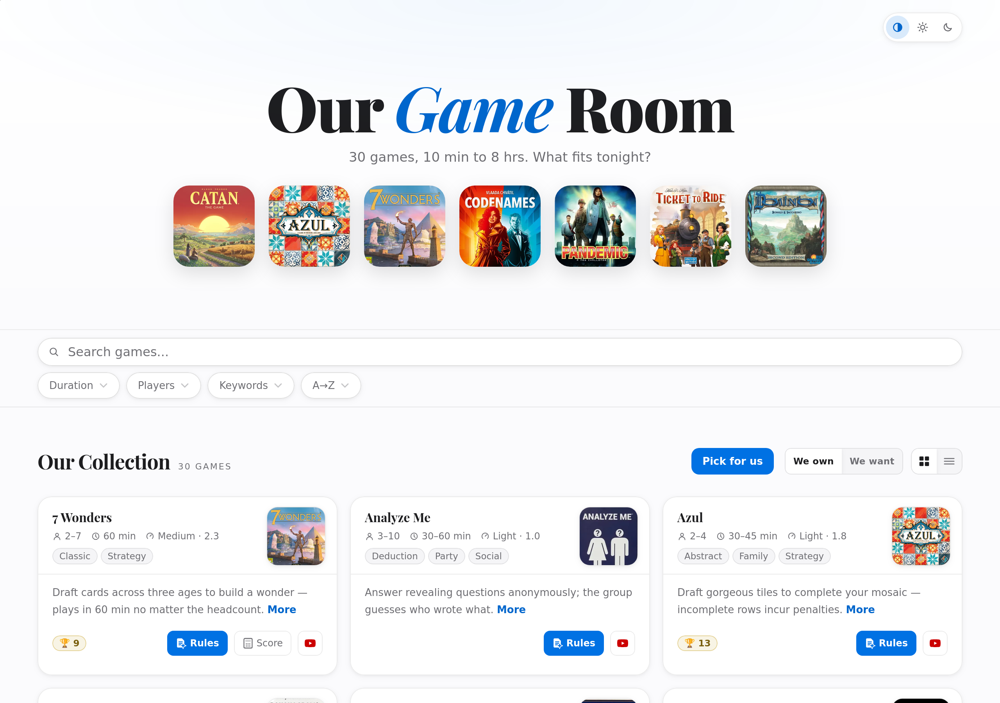
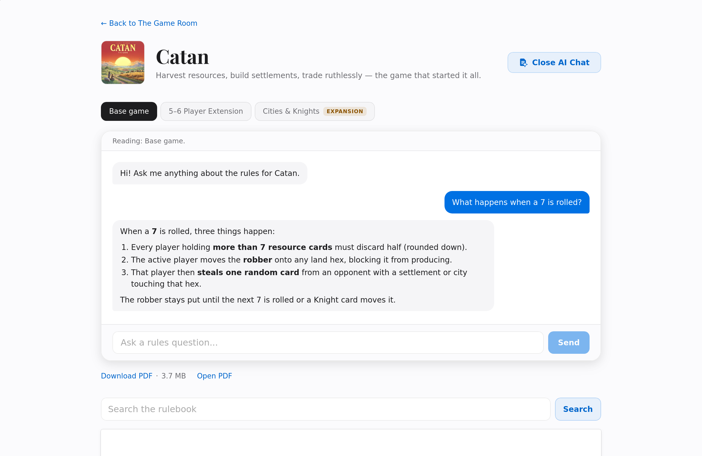
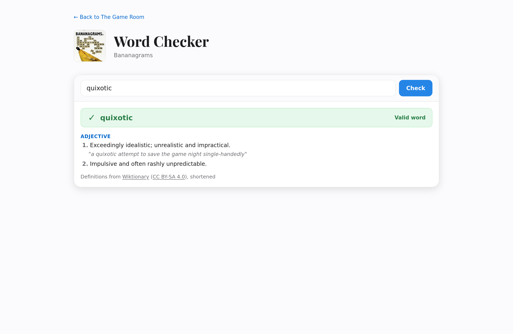
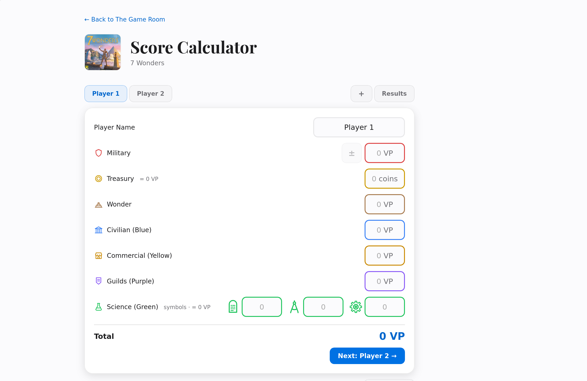
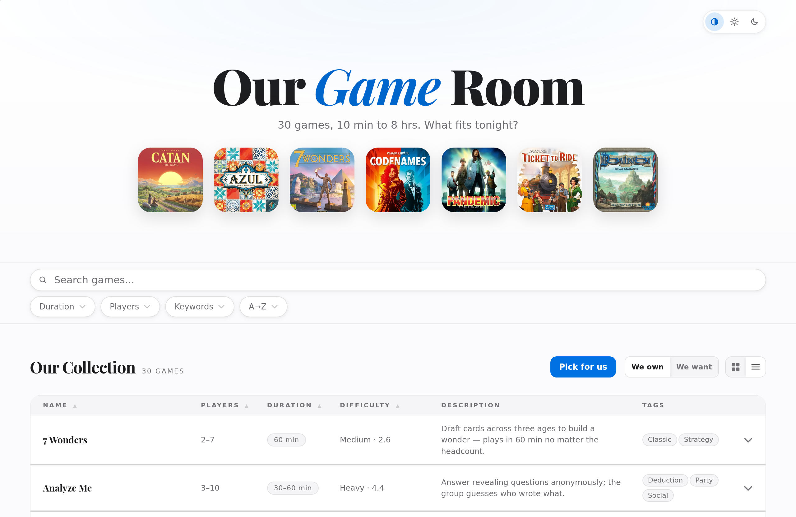

# The Game Room

A web app for a personal board game collection: filter and sort the games by length, player
count and vibe; get a "pick for us" suggestion; read the bundled rulebooks; ask an **AI rules
assistant**; keep score for **7 Wonders**, **Ticket to Ride**, **Dominion** and the card games;
check whether a word is playable in **Bananagrams**; and vote on a shared wishlist. It installs
on a phone and works offline.

## Highlights

- **Shareable filtering.** Time budget, player count, keywords, full-text search and several
  sorts, kept in the URL, so any filtered view can be copied and shared.
- **AI rules assistant.** Each game's rulebook PDF is extracted to text and given to Google
  Gemini, which answers from that game's rules only and streams the reply as it writes.
- **Score pads.** 7 Wonders with its full scoring model (the quadratic science formula
  included), Ticket to Ride (US and Europe), Dominion with Intrigue's Victory cards, and
  round-by-round scores for Uno, Rummy, Hearts, Golf, Spades and Euchre.
- **Bananagrams word checker**, backed by a bundled word list with a public dictionary for
  meanings and newer words.
- **A wishlist friends can vote on and add to.** Anyone can suggest a game; the owner gets an
  email with Approve and Deny links, and an approved game joins the wishlist with its details
  and box art from BoardGameGeek.
- **Phone first, offline and accessible.** Designed for a phone before a desktop, installable,
  and checked for accessibility on every change.

## Screenshots

| AI rules assistant | Word checker | 7 Wonders score calculator |
| --- | --- | --- |
|  |  |  |

A sortable list view is also available:

> The rules-assistant and word-checker screenshots use stubbed API responses for capture; the
> app calls the real services.

## Technologies, and what each gives us

- **React 19, TypeScript 7 (strict) and Vite:** a fast single-page app, with every value typed
  (type coverage at 100%) and the TypeScript 7 native compiler for quick checks.
- **Tailwind CSS 4:** every style a class from one set of design tokens, so the light and dark
  themes stay consistent and linted.
- **A service worker:** the app installs, opens offline, and keeps the rulebooks for offline
  reading.
- **GraphQL (GraphQL Yoga) on one Vercel Function:** one typed API for the rules assistant,
  votes, suggestions and sign-in, with the browser's documents generated from the schema, so
  the two sides can't drift apart.
- **Google Gemini:** the rules assistant's answers, streamed over server-sent events.
- **Turso, through Drizzle,** and **Upstash Redis:** the wishlist, suggestions and sessions,
  moving from Redis to Turso (#290), with every schema change a reviewed migration.
- **Resend:** the approval and magic-link emails.
- **Sentry and Vercel Analytics:** errors from the browser and the API, and usage.
- **Vitest, React Testing Library and axe:** unit and component tests, with accessibility
  assertions and an 80% line-coverage gate on every file.
- **StrykerJS:** mutation testing, which checks that the tests would fail if the code changed,
  not just that it ran.
- **Playwright:** end-to-end tests against the production build, on a desktop and a phone, and
  visual regression in Chromium, Firefox and WebKit.

## Architecture

- **`src/`, the app:** the collection's data compiled in (`src/data/`), the filter store and
  its URL sync (`src/context/`), pure helpers (`src/utils/`), the pages and components
  (`src/components/`), and the service worker (`src/sw/`).
- **`api/`, the one function:** a GraphQL API over the rules assistant, wishlist votes,
  suggestions with email approval, the owner's edits and magic-link sign-in.
- **`scripts/`, the rules pipeline:** turns `public/rules/*.pdf` into the text the assistant
  reads (`rules-text/`), with OCR for scanned rulebooks, and fetches box art and game weights
  from BoardGameGeek.

## Built to be trusted

- **Answer quality is measured.** A golden set of rules questions (`eval/golden-set.json`),
  with verified answers and source quotes, grades the assistant whenever its code changes; it
  must pass 90%. The set includes questions the rulebooks don't answer, where the right answer
  is to say so.
- **The deployed API is probed.** Every deployment, and production twice a day, gets a real
  rules question and a votes query, so a function that fails at load, a missing file or a
  revoked key shows as a red check rather than a silent error. This came from an incident in
  July 2026, where the chat function crashed at load while passing every check before merge.
- **Mutation testing guards the tests.** Each PR mutates the lines it changed, and a monthly
  sweep covers everything, so a test weakened anywhere shows up.

Working on it: [`CONTRIBUTING.md`](CONTRIBUTING.md).
